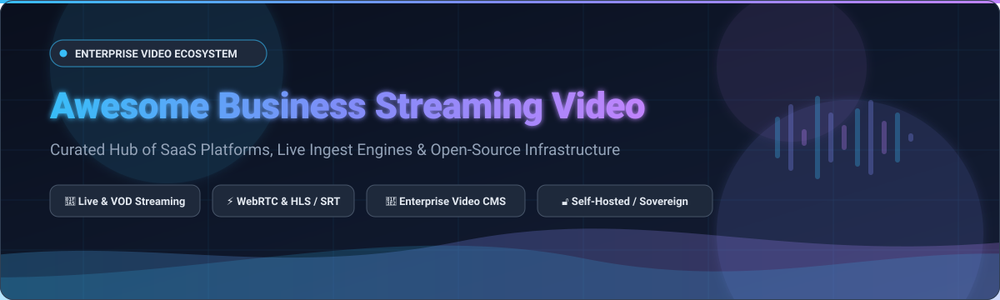

# Awesome Business Streaming Video

  

 

**Curated collection of SaaS products, self-hosted media servers, live streaming engines, and open-source video infrastructure for enterprise video hosting, corporate communications, webinars, and live events.**

---

## 📖 Table of Contents

- [📊 Sector Overview & Market Dynamics](#-sector-overview--market-dynamics)
- [🏢 SaaS/Hosted Platforms](#-saashosted-platforms)
- [🔓 Open-Source GitHub Projects](#-open-source-github-projects)
- [🤝 How to Contribute](#-how-to-contribute)
- [💖 Support & Sponsorship](#-support--sponsorship)
- [📈 Star History](#-star-history)
- [⚖️ Disclaimer](#️-disclaimer)

---

## 📊 Sector Overview & Market Dynamics

The global enterprise video streaming and management market is estimated at approximately **$26B – $30B** (expanding at an ~11–13% CAGR toward 2030). The sector exhibits **moderate concentration / medium fragmentation** (HHI ~850–1,050, with the top tier controlling 42–48% of market share), balanced between horizontal hyper-scalers (Salesforce, IBM, Microsoft) providing broad ecosystems and specialized video architectures (Brightcove, Kaltura, Panopto, Wistia) defending deep enterprise workflows, compliance, and eCDN delivery.

---

## 🏢 SaaS/Hosted Platforms

| Platform | Description | Scale (Revenue / Valuation) | Pricing | Free Tier / Trial Limits |
| :--- | :--- | :--- | :--- | :--- |
| **[Salesforce+](https://www.salesforce.com/plus/)** | Salesforce's proprietary streaming network for original series, live event broadcasts (Dreamforce), release readiness (Agentforce, Analytics, Commerce), and business thought leadership. | **~$300B+ MCap** (~$38B Annual Revenue) | **Free** ($0 / Trailblazer membership) | **Unlimited free access** with free Trailblazer.me account (no time limit, full on-demand library access) |
| **[IBM Video Streaming](https://www.ibm.com/cloud/video)** | Enterprise-grade live and VOD platform powered by Watson AI with automated captioning, multi-CDN delivery, and secure SSO portals. | **~$220B+ MCap** (~$62B Annual Revenue) | **Silver tier starting at $154/mo** (indicative entry tier; Gold at $773/mo; Enterprise at $898/mo) | **30-day free trial** with access to core streaming, Watson live captioning, and IBM ID registration |
| **[Vimeo Enterprise](https://vimeo.com/enterprise)** | Business video platform with SSO/SCIM, centralized library, private showcases, live streaming, AI dubbing, and marketing integrations. | **~$1.1B MCap** (~$415M Annual Revenue) | **Starter tier starting at $20/mo** ($12/mo billed annually; Standard at $33/mo; Enterprise custom) | **Permanent Free plan**: Up to 3 GB managed storage (private/embeddable videos), basic video player and creation tools |
| **[Brightcove](https://www.brightcove.com/)** | High-scale enterprise video streaming platform handling 207M+ weekly views with dynamic delivery, context-aware encoding, and DRM. | **~$120M MCap** (~$190M Annual Revenue) | **Custom annual contract starting at ~$499/mo** (~$6,000/yr minimum entry commitment) | **30-day guided free trial / PoC** on Video Cloud with upload limit (~10 videos) via business email verification |
| **[Kaltura](https://corp.kaltura.com/)** | Modular video platform for education and enterprise featuring virtual classrooms, lecture capture, interactive quizzes, and LMS/VLE integrations. | **~$200M MCap** (~$180M Annual Revenue) | **Media Services starting at $20/mo** base plan + usage (Virtual Classroom starting at $19/mo per organizer) | **30-day free trial**: Includes $100 developer/media platform credit to test APIs, transcoding, and streaming |
| **[Panopto](https://www.panopto.com/)** | Video knowledge and lecture management platform for enterprises and universities with automated transcription, AI search, and LMS integrations. | **~$350M Valuation** (~$30M Annual Revenue; K1 Investment backed) | **Custom annual contracts starting at ~$250/mo** (~$3,000/yr minimum entry contract) | **No enterprise free tier**; offers **Panopto Express** (permanent 100% free browser screen recorder with no time limit/watermarks) plus guided pilot trials upon request |
| **[Vidyard](https://www.vidyard.com/)** | Video marketing and sales engagement platform featuring AI Avatars, CRM pipeline attribution, and automated outbound video messaging. | **~$200M Valuation** (~$25M Annual Revenue; Bessemer backed) | **Pro tier starting at $29/seat/mo** (billed annually, or $89/seat/mo monthly; Plus tier at $89/seat/mo) | **Permanent Free plan**: Up to 5 new video recordings per month, lifetime limit of 15 AI videos, 30-min recording cap per video |
| **[Wistia](https://wistia.com/)** | Video marketing and hosting platform for businesses with lead capture forms, in-video CTAs, heatmaps, A/B testing, and CRM integration. | **~$150M Valuation** (~$32M Annual Revenue; Bootstrapped/Independent) | **Plus tier starting at $24/mo** ($19/mo billed annually; Pro tier at $79/mo billed annually) | **Permanent Free plan**: Up to 10 hosted videos/media files, 200 GB/month streaming bandwidth, 1 user seat |
| **[Qumu (Enghouse Video)](https://www.enghousevideo.com/)** | Enterprise video content management and eCDN live streaming platform with branded viewer portals and engagement analytics. | **~$18M Acquisition Value** (~$22M Annual Revenue; Enghouse Systems subsidiary) | **Enterprise subscriptions starting at ~$800/mo** (billed annually for 500+ seat organizations) | **14-day assisted proof-of-concept / demo trial** for enterprise organizations via Enghouse sales consultation |
| **[Dacast](https://www.dacast.com/)** | Professional live streaming and VOD hosting platform featuring CloudFront/Akamai CDN delivery, SRT/RTMP ingest, and paywall monetization. | **~$20M Valuation** (~$8M Annual Revenue; Bootstrapped/Private) | **Starter plan starting at $39/mo** (billed annually at $468/yr; Scale plan at $165/mo) | **14-day free trial**: Includes 10 GB total bandwidth, 2 GB video storage, 1 active channel, full HD streaming testing |

---

## 🔓 Open-Source GitHub Projects

Curated open-source projects for self-hosting, video infrastructure, media encoding, WebRTC conferencing, and broadcast pipelines. Sorted by GitHub stars in descending order.

1. **[OBS Studio](https://github.com/obsproject/obs-studio)**   
   🎥 Free and open-source software for video recording and live streaming. Supports multi-source scene composition, RTMP/SRT streaming, studio mode, and audio mixing with high-performance real-time video capture.

2. **[FFmpeg](https://github.com/FFmpeg/FFmpeg)**   
   ⚙️ The universal leading multimedia framework capable of decoding, encoding, transcoding, muxing, demuxing, streaming, filtering, and playing virtually every video format created.

3. **[Jellyfin](https://github.com/jellyfin/jellyfin)**   
   📺 Free software media system (GPL) for organizing, managing, and streaming internal video and media libraries. Features hardware acceleration transcoding, multi-user access control, and cross-platform native apps.

4. **[Jitsi Meet](https://github.com/jitsi/jitsi-meet)**   
   📞 Fully encrypted, 100% open-source video conferencing solution that can be deployed on enterprise infrastructure. Supports screen sharing, recording, live streaming to YouTube, and dial-in integration.

5. **[SRS (Simple Realtime Server)](https://github.com/ossrs/srs)**   
   🚀 High-performance, production-grade video streaming cluster server supporting RTMP, WebRTC, HLS, HTTP-FLV, and SRT protocols. Powers large-scale video delivery pipelines across thousands of companies.

6. **[LiveKit](https://github.com/livekit/livekit)**   
   ⚡ End-to-end open-source WebRTC stack designed for building real-time video, audio, and multimodal AI streaming applications at massive scale.

7. **[PeerTube](https://github.com/Chocobozzz/PeerTube)**   
   🌐 Decentralized, federated video hosting platform (AGPL) powered by ActivityPub and WebTorrent P2P distribution to drastically reduce server streaming bandwidth for corporate and educational institutions.

8. **[Owncast](https://github.com/owncast/owncast)**   
   📡 Self-hosted live streaming and chat server for independent broadcasting. Standalone single-binary Go deployment with built-in HLS packaging and customizable web viewer interface.

9. **[BigBlueButton](https://github.com/bigbluebutton/bigbluebutton)**   
   🎓 Open-source virtual classroom and enterprise training web conferencing system designed with multi-user whiteboards, breakout rooms, polling, screen sharing, and LMS integration.

10. **[Janus Gateway](https://github.com/meetecho/janus-gateway)**   
    🔌 General-purpose WebRTC server written in C, providing high-speed modular plugins for video broadcasting, SIP gateway integration, audio bridges, and video room routing.

11. **[Restreamer](https://github.com/datarhei/restreamer)**   
    🔄 Open-source live streaming GUI that lets you broadcast H.264/H.265 video directly to your website and restream simultaneously to YouTube, Twitch, Facebook, and custom RTMP endpoints.

12. **[MediaCMS](https://github.com/mediacms-io/mediacms)**   
    📦 Modern open-source video content management system (CMS) built with Django, Celery, and React. Delivers an enterprise internal YouTube alternative with multi-format transcoding, HLS playback, and REST APIs.

13. **[Ant Media Server](https://github.com/ant-media/Ant-Media-Server)**   
    ⏱️ Real-time, ultra-low latency streaming engine supporting WebRTC (under 0.5s latency), CMAF, HLS, and RTMP with adaptive bitrate streaming and auto-scaling support.

14. **[Oryx (SRS Stack)](https://github.com/ossrs/oryx)**   
    🛠️ All-in-one lightweight video cloud solution built on SRS, Go, React, and FFmpeg. Features one-click Docker deployment, automatic SSL/HTTPS, virtual live events, multi-platform restreaming, and DVR recording.

15. **[Opencast](https://github.com/opencast/opencast)**   
    🏛️ Free, open-source enterprise lecture capture and video management platform designed for higher education institutions and large corporate learning portals.

16. **[SendRec](https://github.com/sendrec/sendrec)**   
    💬 Open-source asynchronous video messaging platform (self-hosted Loom alternative). Features in-browser screen and webcam recording, AI transcription with local Whisper, CTA buttons, viewer heatmaps, and GDPR compliance.

---

### 🧩 Architectural Blueprints for Self-Hosted Enterprise Video

Organizations can compose transparent, data-sovereign video platforms using these open-source building blocks:
* **Ingest & Low-Latency Transcoding:** Deploy **SRS** or **Ant Media Server** for RTMP/SRT/WebRTC ingest and adaptive bitrate transcoding.
* **Corporate Video Library & On-Demand Portal:** Pair **MediaCMS** or **Jellyfin** with S3-compatible object storage (MinIO/Ceph) for indexed knowledge bases and RBAC access controls.
* **Large-Scale Internal Broadcasting:** Use **PeerTube** for federated P2P bandwidth reduction across branch offices or **Restreamer** for multi-destination distribution.
* **Interactive Communications & Town Halls:** Integrate **Jitsi Meet**, **BigBlueButton**, or **LiveKit** for synchronized real-time multi-party video.

---

## 🤝 How to Contribute

Contributions are welcome! Please follow these guidelines:

1. 🍴 Fork the repository.
2. 🌿 Create a new feature branch (`git checkout -b feature/add-new-streaming-tool`).
3. 📝 Add or update entries in `README.md` keeping formatting consistent and descriptions factual.
4. 🚀 Open a Pull Request with a clear summary of your additions.

---

## 💖 Support & Sponsorship

If you find this curated ecosystem directory helpful for your team, company, or open-source projects:

- ⭐ **Star this repository** to show appreciation and help other developers discover it!
- 🍴 **Fork and share** with colleagues building video streaming pipelines.
- ☕ **Support continuous maintenance & updates**: Buy a coffee or sponsor through the [GitHub Sponsors Dashboard](https://github.com/sponsors/ishandutta2007).

---

## 📈 Star History

---

## ⚖️ Disclaimer

- This is an independent **community-curated directory** — listings do not imply commercial endorsement.
- All enterprise video deployments must adhere to applicable compliance frameworks (GDPR, CCPA, SOC2, HIPAA, WCAG accessibility).
- Self-hosted open-source software requires dedicated infrastructure hardening, SSL certificates, access controls, and CDN edge termination.
